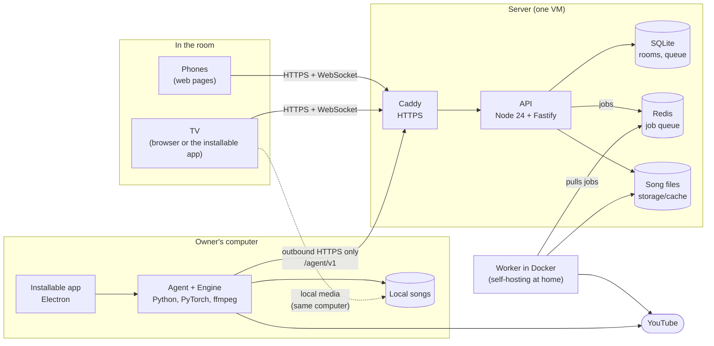
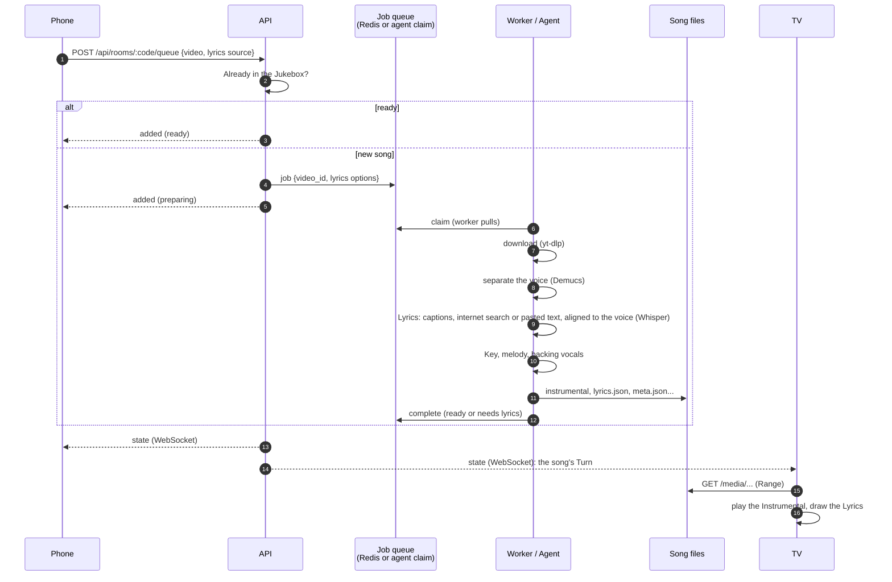
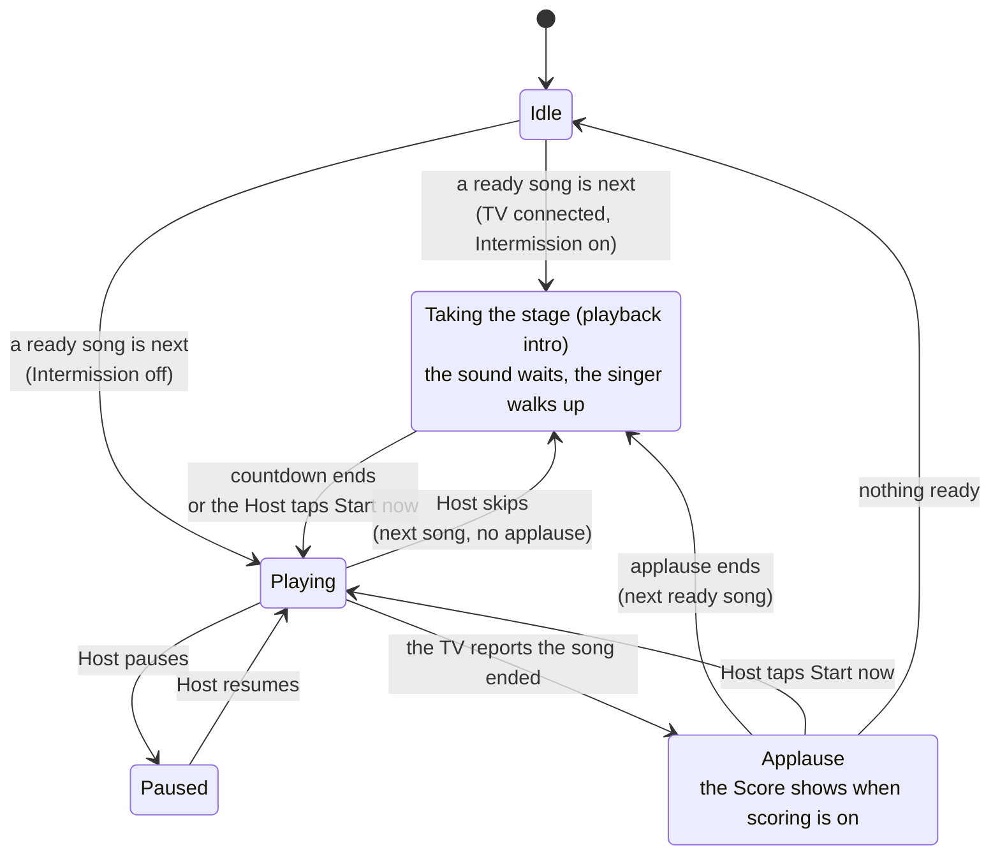
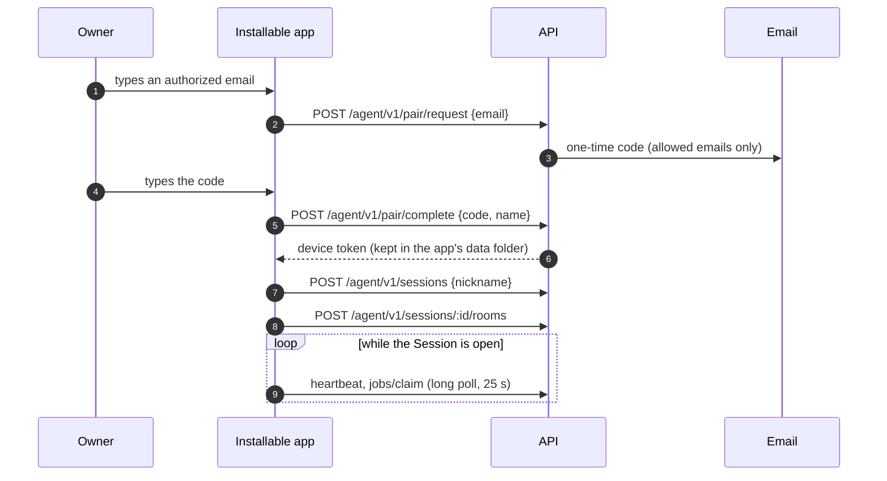

# Architecture

**English** · [Português (Brasil)](architecture.pt-BR.md)

How Singalong is built and why it is shaped this way. The words in **bold** (Room, Host, Jukebox, Intermission...) are defined in the [glossary](GLOSSARY.md); each decision is recorded in an [ADR](adr/).

## The parts



| Part | Job | Why it is this technology |
|---|---|---|
| Phones (`apps/web`, `room.html`) | Join a Room, add songs, choose the Key, react, sing on the Stage | Guests install nothing: they scan a QR code ([ADR 0007](adr/0007-web-clients-not-native-apps.md)) |
| TV (`apps/web`, `tv.html`) | Where the music plays the Instrumental, draws the Lyrics, scores, shows the Intermission | Any browser is a TV; pitch shift and lyrics happen in the browser ([ADR 0008](adr/0008-render-lyrics-and-key-in-the-browser.md)) |
| API (`apps/api`) | Rooms, Queue, real-time state, song files, the agent API | Real-time rooms with many sockets; same language as the web ([ADR 0003](adr/0003-node-fastify-api.md)) |
| SQLite | Rooms, Queue, settings, play history | One server, nothing to operate ([ADR 0006](adr/0006-sqlite.md)) |
| Redis | Job queue between the API and a self-hosted worker | Language-neutral contract; the worker pulls ([ADR 0005](adr/0005-workers-pull-jobs.md)) |
| Worker (`apps/worker`) | Download, vocal separation, Lyrics, Key, melody, MP4 export | The audio tools only exist in Python ([ADR 0004](adr/0004-python-worker.md)) |
| Installable app (`apps/desktop`) + Engine (`apps/engine`) | Prepares Songs on the Owner's computer; shows the TV and the Host page | No paid server and no owner PC left on for everyone ([ADR 0012](adr/0012-installable-app-prepares-songs-locally.md)) |

### Frameworks and libraries

Singalong uses no full-stack framework: it composes these pieces ([ADR 0016](adr/0016-no-full-stack-framework.md)). The API is planned to move to NestJS on top of the same Fastify.

| Piece | Role |
|---|---|
| Fastify (`@fastify/websocket`) | HTTP server and WebSockets |
| React | The pages' interface |
| Vite | Builds the four pages |
| Electron | The installable app |
| Playwright and axe | End-to-end and accessibility tests |
| `node:test` | Unit and API tests |
| PyTorch, Demucs, Whisper (stable-ts), yt-dlp, ffmpeg | The worker's audio work |

## Where the words live in the code

| Term | Code |
|---|---|
| Room, Queue, Turn, Intermission | `apps/api/src/rooms.js` (state and rules), `apps/api/src/queue-logic.js` (order, Fair rotation) |
| TV | `apps/web/src/tv/` (`TvPage.tsx`, `controller.ts` for sound and scoring, `Interlude.tsx`, `Lobby.tsx`) |
| Phone (Room page) | `apps/web/src/room/` |
| Stage | `apps/web/src/stage/StagePage.tsx` |
| Lyrics drawing, Key, Score | `apps/web/src/lib/` (`lyrics-view.js`, `engine.js`, `scoring.js`) |
| Song preparation | `apps/worker/singalong_worker/pipeline.py` and `runner.py` |
| Agent API, Pairing, Session | `apps/api/src/agents.js`, `apps/api/src/routes/agent.js` |
| Engine assembly | `apps/engine/src/assemble.js` (from `apps/engine/manifest.json`) |
| Local media | `apps/worker/singalong_worker/media_server.py` |
| UI texts | `apps/web/src/i18n/{pt,en,es}.js` |
| Brand tokens | `apps/web/src/styles/theme-bridge.css` |

## A song request, from the phone to the TV



Every step writes its file and skips itself when the file already exists, so a preparation interrupted halfway resumes where it stopped.

## A Turn in the Room, with the Intermission

The server owns the Room's state; the TV owns the sound and reports its position ([ADR 0009](adr/0009-server-owns-room-state-tv-owns-sound.md)).



Each phase lasts `INTERMISSION_APPLAUSE_SECONDS` and `INTERMISSION_STAGE_SECONDS` (15 s each). Devices receive how much time is left and count down on their own, so their clocks never need to agree with the server's.

### Real-time messages

One WebSocket per device (`/api/rooms/:code/ws?role=tv|controller`):

| Message | From → to | Meaning |
|---|---|---|
| `state` | server → everyone | The whole Room: Queue, Turn, settings, Intermission, people in the Room |
| `position` | TV → server → phones | Where the song is, every 2 s (the Stage keeps the lyrics in time between messages) |
| `lyrics` | TV → server → phones | The Lyrics the TV loaded, for the Stage (needed when the songs are local media) |
| `seek` | server → TV | The Host moved the song |
| `reaction` | phone → server → TV | A Reaction to float on the TV |
| `ended`, `score` | TV → server | The song ended; its Score |

## Pairing the installable app



The agent only makes outbound requests, so it works behind any home router without opening ports. The server sends it only a video id and a closed set of options; the YouTube login never leaves the Owner's computer.

## Repository layout

```
apps/
  api/        Node API (Fastify): src/rooms.js, src/agents.js, src/routes/
  web/        React + Vite: src/{landing,room,tv,stage,ui,lib,i18n,styles}, e2e/ (Playwright)
  worker/     Python: singalong_worker/ (pipeline, runner, align, lyrics...), tests/
  desktop/    Electron: src/ (main, controller), ui/ (the app's own screens)
  engine/     Assembles the Python runtime from manifest.json
brand/        Logo and icon sources
deploy/       The cloud VM: Caddyfile, docker-compose.prod.yml, deploy.sh
docs/         This folder
```

One repository, one version for all apps; each app keeps its own dependencies ([ADR 0002](adr/0002-monorepo-one-app-per-runtime.md)). The history of how each part came to be is in the [PLAN](PLAN.md); the installer and agent design is in the [TRD](TRD.md).
