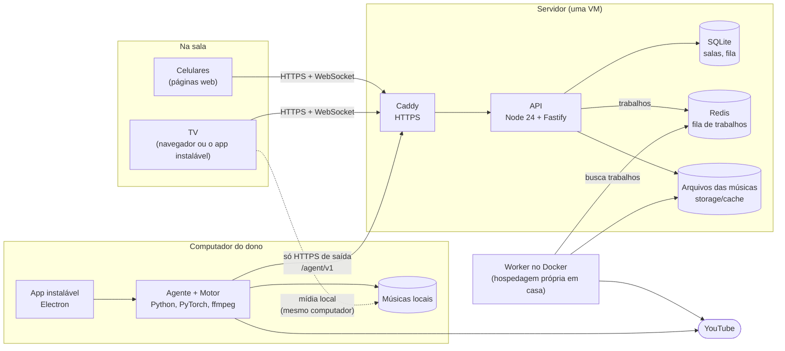
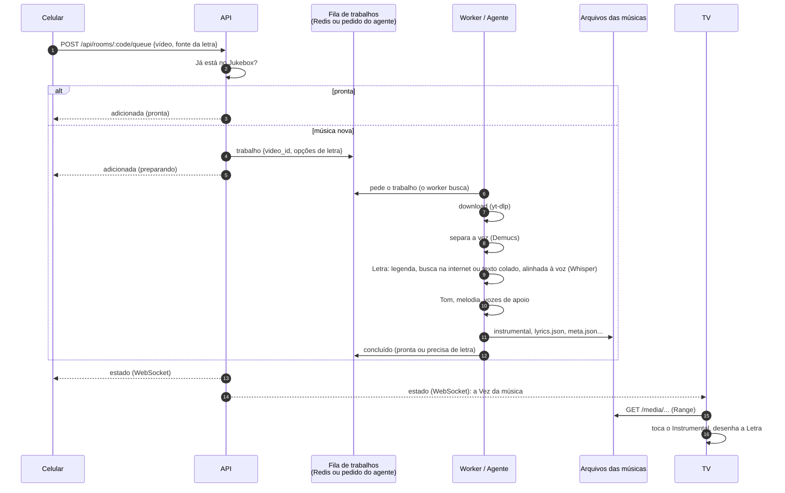
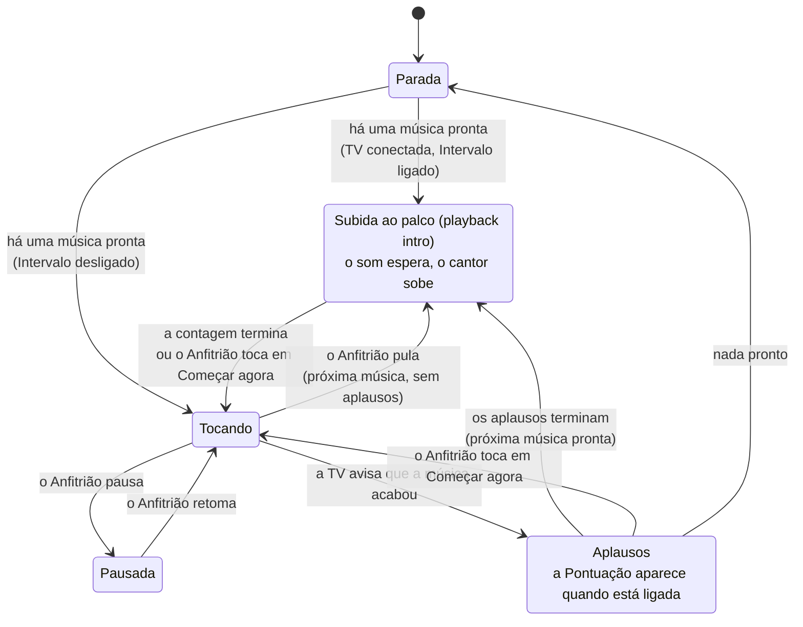
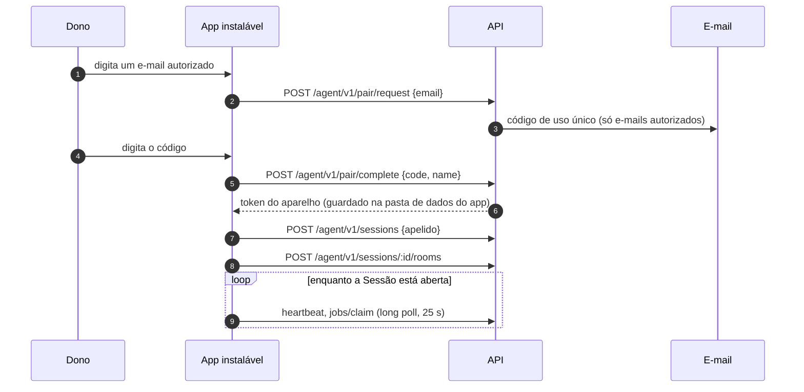

# Arquitetura

[English](architecture.md) · **Português (Brasil)**

Como o Singalong é construído e por que tem esta forma. As palavras em **negrito** (Sala, Anfitrião, Jukebox, Intervalo...) estão definidas no [glossário](GLOSSARY.pt-BR.md); cada decisão está registrada num [ADR](adr/).

## As partes



| Parte | Função | Por que esta tecnologia |
|---|---|---|
| Celulares (`apps/web`, `room.html`) | Entrar na Sala, pôr músicas, escolher o Tom, reagir, cantar no Palco | O convidado não instala nada: lê um QR code ([ADR 0007](adr/0007-web-clients-not-native-apps.pt-BR.md)) |
| TV (`apps/web`, `tv.html`) | Toca o Instrumental, desenha a Letra, pontua, mostra o Intervalo | Qualquer navegador vira TV; troca de tom e letra acontecem no navegador ([ADR 0008](adr/0008-render-lyrics-and-key-in-the-browser.pt-BR.md)) |
| API (`apps/api`) | Salas, Fila, estado em tempo real, arquivos das músicas, a API do agente | Salas em tempo real com muitas conexões; a mesma linguagem da web ([ADR 0003](adr/0003-node-fastify-api.pt-BR.md)) |
| SQLite | Salas, Fila, ajustes, histórico do que tocou | Um servidor só, nada para administrar ([ADR 0006](adr/0006-sqlite.pt-BR.md)) |
| Redis | Fila de trabalhos entre a API e um worker hospedado por conta própria | Contrato neutro entre linguagens; o worker busca o trabalho ([ADR 0005](adr/0005-workers-pull-jobs.pt-BR.md)) |
| Worker (`apps/worker`) | Download, separação da voz, Letra, Tom, melodia, exportação em MP4 | As ferramentas de áudio só existem em Python ([ADR 0004](adr/0004-python-worker.pt-BR.md)) |
| App instalável (`apps/desktop`) + Motor (`apps/engine`) | Prepara as Músicas no computador do Dono; mostra a TV e a página do Anfitrião | Sem servidor pago e sem o PC do dono ligado para todo mundo ([ADR 0012](adr/0012-installable-app-prepares-songs-locally.pt-BR.md)) |

### Frameworks e bibliotecas

O Singalong não usa framework completo: ele compõe estas peças ([ADR 0016](adr/0016-no-full-stack-framework.pt-BR.md)). A API está migrando para NestJS em cima do mesmo Fastify, com MikroORM sobre o SQLite ([ADR 0017](adr/0017-api-on-nestjs-with-mikroorm.pt-BR.md)).

| Peça | Papel |
|---|---|
| Fastify | Servidor HTTP, sob o NestJS |
| NestJS | Os módulos e a injeção de dependência da API, sobre o mesmo Fastify, e o gateway do WebSocket da Sala (`@nestjs/platform-ws`, [ADR 0018](adr/0018-room-websocket-on-a-nest-gateway.pt-BR.md)) |
| MikroORM | A camada de banco sobre o SQLite: entidades e migrações (`apps/api/src/database/`) |
| React | A interface das páginas |
| Vite | O build das quatro páginas |
| Electron | O app instalável |
| Playwright e axe | Testes de ponta a ponta e de acessibilidade |
| `node:test` | Testes unitários e da API |
| PyTorch, Demucs, Whisper (stable-ts), yt-dlp, ffmpeg | O trabalho de áudio do worker |

## Onde as palavras moram no código

| Termo | Código |
|---|---|
| Sala, Fila, Vez, Intervalo | `apps/api/src/rooms/` (`room.service.ts` para o estado e as regras, `queue-logic.ts` para a ordem e o Rodízio justo, `rooms.gateway.ts` para o WebSocket) |
| TV | `apps/web/src/tv/` (`TvPage.tsx`, `controller.ts` para som e pontuação, `Interlude.tsx`, `Lobby.tsx`) |
| Celular (página da Sala) | `apps/web/src/room/` |
| Palco | `apps/web/src/stage/StagePage.tsx` |
| Desenho da letra, Tom, Pontuação | `apps/web/src/lib/` (`lyrics-view.ts`, `engine.ts`, `scoring.ts`) |
| Preparo das músicas | `apps/worker/singalong_worker/pipeline.py` e `runner.py` |
| O que as páginas e a API trocam | `apps/api/src/protocol.ts` (o site o lê pelo `apps/web/src/lib/types.ts`) |
| API do agente, Pareamento, Sessão | `apps/api/src/agents/` (`agent.service.ts`, `pairing.controller.ts`, `agent.controller.ts`, `cloud.ts`) |
| Montagem do Motor | `apps/engine/src/assemble.js` (a partir de `apps/engine/manifest.json`) |
| Mídia local | `apps/worker/singalong_worker/media_server.py` |
| Textos da interface | `apps/web/src/i18n/{pt,en,es}.ts` |
| Tokens da marca | `apps/web/src/styles/theme-bridge.css` |

## Um pedido de música, do celular à TV



Cada etapa grava o seu arquivo e se pula quando o arquivo já existe; assim, um preparo interrompido no meio continua de onde parou.

## Uma Vez na Sala, com o Intervalo

O servidor é dono do estado da Sala; a TV é dona do som e informa a posição ([ADR 0009](adr/0009-server-owns-room-state-tv-owns-sound.pt-BR.md)).



Cada fase dura `INTERMISSION_APPLAUSE_SECONDS` e `INTERMISSION_STAGE_SECONDS` (15 s cada). Os aparelhos recebem quanto tempo falta e contam sozinhos, então os relógios deles não precisam bater com o do servidor.

### Mensagens em tempo real

Um WebSocket por aparelho (`/api/rooms/ws?code=…&role=tv|controller`):

| Mensagem | De → para | Significado |
|---|---|---|
| `state` | servidor → todos | A Sala inteira: Fila, Vez, ajustes, Intervalo, quem está na Sala |
| `position` | TV → servidor → celulares | Onde a música está, a cada 2 s (o Palco mantém a letra no ritmo entre uma mensagem e outra) |
| `lyrics` | TV → servidor → celulares | A Letra que a TV carregou, para o Palco (necessária quando as músicas são mídia local) |
| `seek` | servidor → TV | O Anfitrião mudou a posição da música |
| `reaction` | celular → servidor → TV | Uma Reação para flutuar na TV |
| `ended`, `score` | TV → servidor | A música acabou; a Pontuação dela |

## Pareamento do app instalável



O agente só faz pedidos de saída, então funciona atrás de qualquer roteador de casa sem abrir portas. O servidor manda a ele só o id de um vídeo e um conjunto fechado de opções; o login do YouTube nunca sai do computador do Dono.

## Organização do repositório

```
apps/
  api/        API em Node (NestJS sobre o Fastify, MikroORM): src/app.ts, src/database/, uma pasta por área em
              src/{admin,release,cache,songs,agents,rooms}/
  web/        React + Vite: src/{landing,room,tv,stage,ui,lib,i18n,styles}, e2e/ (Playwright)
  worker/     Python: singalong_worker/ (pipeline, runner, align, lyrics...), tests/
  desktop/    Electron: src/ (main, controller), ui/ (as telas do próprio app)
  engine/     Monta o ambiente Python a partir do manifest.json
brand/        Fontes do logotipo e do ícone
deploy/       A VM na nuvem: Caddyfile, docker-compose.prod.yml, deploy.sh
docs/         Esta pasta
```

Um repositório, uma versão para todos os apps; cada app mantém as próprias dependências ([ADR 0002](adr/0002-monorepo-one-app-per-runtime.pt-BR.md)). A história de como cada parte surgiu está no [PLAN](PLAN.pt-BR.md); o desenho do instalador e do agente está no [TRD](TRD.pt-BR.md).
