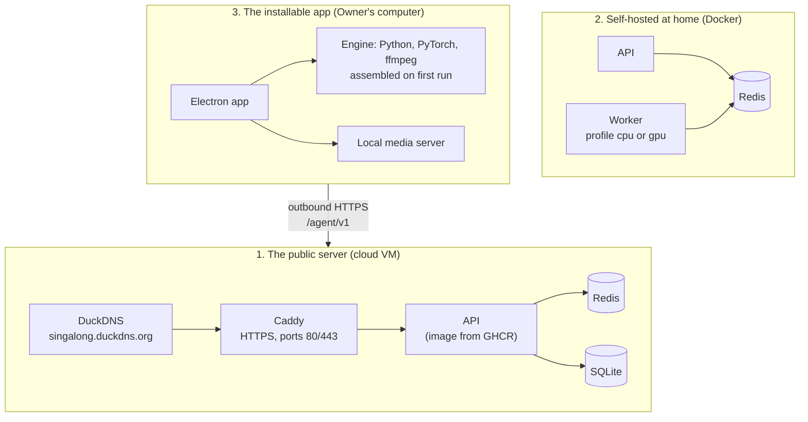
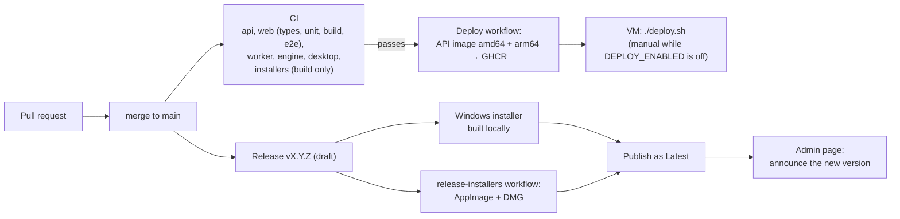

# Infrastructure

**English** · [Português (Brasil)](infrastructure.pt-BR.md)

Where Singalong runs, how a change reaches people, and what each setting does. Every piece here is free while the project earns no money ([ADR 0001](adr/0001-zero-cost-while-non-profit.md)).

## Three ways to run it



### 1. The public server

One Ubuntu VM on Oracle Cloud's Always Free tier runs [`deploy/docker-compose.prod.yml`](../deploy/docker-compose.prod.yml): **Caddy → API → Redis**, with only ports 80 and 443 open. [DuckDNS](https://www.duckdns.org) gives the free subdomain; Caddy gets and renews its HTTPS certificate on its own. HTTPS is not optional: browsers only grant the microphone and the pitch-shift AudioWorklet to secure pages ([ADR 0013](adr/0013-free-vm-with-caddy-and-duckdns.md)).

The server cannot prepare songs: YouTube blocks downloads from cloud IPs (measured: 0 of 8 videos). New songs come from the Owners' installable apps; the server only meets people, keeps the Rooms and serves songs that are already prepared.

Setup, step by step: [`deploy/README.md`](../deploy/README.md).

### 2. Self-hosted at home

[`docker-compose.yml`](../docker-compose.yml) runs the API, Redis and a worker on one computer, with the YouTube cookies in `secrets/`:

```powershell
docker compose --profile gpu up -d --build     # NVIDIA GPU
docker compose --profile cpu up -d --build     # CPU only
```

The worker pulls jobs from Redis ([ADR 0005](adr/0005-workers-pull-jobs.md)).

### 3. The installable app

The Owner installs `singalong_karaoke` (Windows, macOS on Apple Silicon, Linux), pairs it with a server and starts a Session. On first run it assembles the **Engine** from the official sources pinned in [`apps/engine/manifest.json`](../apps/engine/manifest.json), with SHA-256 checks; a CPU or a supported GPU is picked automatically. Songs are prepared and stored on the Owner's computer and reach the TV through the local media server ([ADR 0012](adr/0012-installable-app-prepares-songs-locally.md)).

## From a change to people



| Workflow | When | What |
|---|---|---|
| [`ci.yml`](../.github/workflows/ci.yml) | Every push to `main` | Tests every app; builds the installers without publishing; builds the worker image |
| [`deploy.yml`](../.github/workflows/deploy.yml) | After CI passes on `main` | Publishes the API image to GHCR; updates the VM over SSH only when the variable `DEPLOY_ENABLED` is `true` |
| [`release-installers.yml`](../.github/workflows/release-installers.yml) | By hand, with a tag | Builds the Linux AppImage and the macOS DMG and attaches them to that release |

The release steps are in [AGENTS.md → Release](../AGENTS.md#release).

### Going back to an earlier API

Every API image is published twice: as `latest` and as the short SHA of its commit. On the VM, `IMAGE_TAG=<sha> ./deploy.sh` pulls and starts that earlier image; the variable from the shell wins over the `.env`. The database stays as the newer version left it, so a migration must keep the earlier image working on it ([ADR 0017](adr/0017-api-on-nestjs-with-mikroorm.md)).

## Settings

The API reads environment variables ([`apps/api/src/config.js`](../apps/api/src/config.js)):

| Variable | Default | What it does |
|---|---|---|
| `PORT`, `HOST` | `3000`, `0.0.0.0` | Where the API listens |
| `PUBLIC_URL` | empty | The address phones reach, used in the TV's QR code |
| `REDIS_URL` | `redis://localhost:6379/0` | The job queue |
| `DB_PATH`, `STORAGE_ROOT` | `storage/` | SQLite file and song files |
| `CACHE_MAX_GB` | `20` | Above it, the least-sung songs are deleted; `0` turns cleaning off (the cloud uses `0`) |
| `INTERMISSION_APPLAUSE_SECONDS`, `INTERMISSION_STAGE_SECONDS` | `15`, `15` | Length of each Intermission phase; `0` turns that phase off |
| `ADMIN_TOKEN`, `ADMIN_PATH` | empty | Turn on pairing and the secret admin page |
| `PAIR_ALLOWED_EMAILS` | empty | Emails that may receive a pairing code |
| `ENABLED_TO_SEND_TO_CLOUD` | empty | Emails whose computers copy their songs to the cloud (Hybrid mode) |
| `BREVO_API_KEY`, `MAIL_FROM`, `MAIL_FROM_NAME` | empty | Sending the pairing email |
| `APP_LATEST_VERSION`, `APP_MIN_VERSION`, `APP_NOTES`, `APP_DOWNLOAD_URL` | empty | The update notice in the installed app (the admin page overrides them) |
| `TRUST_PROXY` | off | `1` behind Caddy, so rate limits see the real IP |
| `LOG_LEVEL` | `info` | Log detail |

The self-hosted worker reads `YTDLP_COOKIES` and `YTDLP_COOKIES_POLICY` (`when-asked` by default: try without the login first), `DEMUCS_DEVICE`, `MAX_DURATION_SECONDS`, `MIN_FREE_GB`, `SEPARATE_TIMEOUT_SECONDS` and `WORKER_MAX_ATTEMPTS`; see [`docker-compose.yml`](../docker-compose.yml).

## Backups and data

- **Rooms and queue**: the SQLite file in the `api-data` volume; Rooms idle for 24 hours are deleted. Nothing copies it automatically yet: step 3 of the [ROADMAP](ROADMAP.md) makes `deploy.sh` keep the last five copies.
- **Songs**: `storage/cache/<video_id>/`, never in the repository or in an image (the repository is public). [`deploy/sync-library.sh`](../deploy/sync-library.sh) copies prepared songs to the VM when needed.
- **Secrets**: `secrets/` and the VM's `.env`, both outside git.
