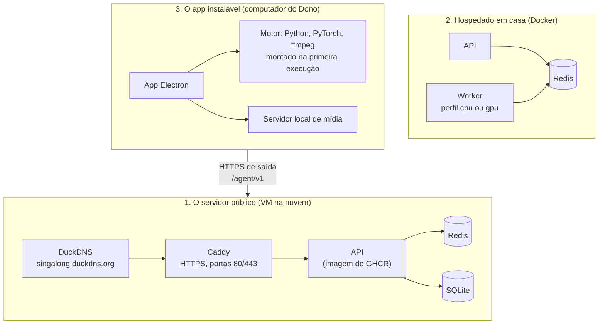
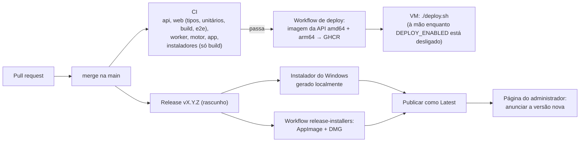

# Infraestrutura

[English](infrastructure.md) · **Português (Brasil)**

Onde o Singalong roda, como uma mudança chega às pessoas e o que cada ajuste faz. Tudo aqui é gratuito enquanto o projeto não gera dinheiro ([ADR 0001](adr/0001-zero-cost-while-non-profit.pt-BR.md)).

## Três formas de rodar



### 1. O servidor público

Uma VM Ubuntu no plano Always Free da Oracle Cloud roda o [`deploy/docker-compose.prod.yml`](../deploy/docker-compose.prod.yml): **Caddy → API → Redis**, com só as portas 80 e 443 abertas. O [DuckDNS](https://www.duckdns.org) dá o subdomínio gratuito; o Caddy obtém e renova o certificado HTTPS sozinho. O HTTPS não é opcional: o navegador só libera o microfone e o AudioWorklet da troca de tom em páginas seguras ([ADR 0013](adr/0013-free-vm-with-caddy-and-duckdns.pt-BR.md)).

O servidor não consegue preparar músicas: o YouTube bloqueia downloads vindos de IPs de nuvem (medido: 0 de 8 vídeos). As músicas novas vêm dos apps instaláveis dos Donos; o servidor só serve de ponto de encontro, guarda as Salas e entrega as músicas já preparadas.

Passo a passo da instalação: [`deploy/README.md`](../deploy/README.md).

### 2. Hospedado em casa

O [`docker-compose.yml`](../docker-compose.yml) roda a API, o Redis e um worker num computador só, com os cookies do YouTube em `secrets/`:

```powershell
docker compose --profile gpu up -d --build     # GPU NVIDIA
docker compose --profile cpu up -d --build     # só CPU
```

O worker busca os trabalhos no Redis ([ADR 0005](adr/0005-workers-pull-jobs.pt-BR.md)).

### 3. O app instalável

O Dono instala o `singalong_karaoke` (Windows, macOS em Apple Silicon, Linux), pareia com um servidor e inicia uma Sessão. Na primeira execução ele monta o **Motor** a partir das fontes oficiais fixadas no [`apps/engine/manifest.json`](../apps/engine/manifest.json), conferindo o SHA-256; a CPU ou uma GPU compatível é escolhida sozinha. As músicas são preparadas e guardadas no computador do Dono e chegam à TV pelo servidor local de mídia ([ADR 0012](adr/0012-installable-app-prepares-songs-locally.pt-BR.md)).

## De uma mudança até as pessoas



| Workflow | Quando | O quê |
|---|---|---|
| [`ci.yml`](../.github/workflows/ci.yml) | A cada push na `main` | Testa todos os apps; gera os instaladores sem publicar; constrói a imagem do worker |
| [`deploy.yml`](../.github/workflows/deploy.yml) | Depois que o CI passa na `main` | Publica a imagem da API no GHCR; atualiza a VM por SSH só quando a variável `DEPLOY_ENABLED` é `true` |
| [`release-installers.yml`](../.github/workflows/release-installers.yml) | À mão, com uma tag | Gera o AppImage do Linux e o DMG do macOS e os anexa àquela release |

Os passos da release estão no [AGENTS.pt-BR.md → Release](../AGENTS.pt-BR.md#release).

## Ajustes

A API lê variáveis de ambiente ([`apps/api/src/config.js`](../apps/api/src/config.js)):

| Variável | Padrão | O que faz |
|---|---|---|
| `PORT`, `HOST` | `3000`, `0.0.0.0` | Onde a API escuta |
| `PUBLIC_URL` | vazio | O endereço que os celulares alcançam, usado no QR code da TV |
| `REDIS_URL` | `redis://localhost:6379/0` | A fila de trabalhos |
| `DB_PATH`, `STORAGE_ROOT` | `storage/` | Arquivo do SQLite e arquivos das músicas |
| `CACHE_MAX_GB` | `20` | Acima disso, as músicas menos cantadas são apagadas; `0` desliga a limpeza (a nuvem usa `0`) |
| `INTERMISSION_APPLAUSE_SECONDS`, `INTERMISSION_STAGE_SECONDS` | `15`, `15` | Duração de cada fase do Intervalo; `0` desliga aquela fase |
| `ADMIN_TOKEN`, `ADMIN_PATH` | vazio | Ligam o pareamento e a página secreta do administrador |
| `PAIR_ALLOWED_EMAILS` | vazio | E-mails que podem receber o código de pareamento |
| `ENABLED_TO_SEND_TO_CLOUD` | vazio | E-mails cujos computadores copiam as músicas para a nuvem (Modo híbrido) |
| `BREVO_API_KEY`, `MAIL_FROM`, `MAIL_FROM_NAME` | vazio | O envio do e-mail de pareamento |
| `APP_LATEST_VERSION`, `APP_MIN_VERSION`, `APP_NOTES`, `APP_DOWNLOAD_URL` | vazio | O aviso de atualização no app instalado (a página do administrador tem prioridade) |
| `TRUST_PROXY` | desligado | `1` atrás do Caddy, para os limites de pedidos verem o IP real |
| `LOG_LEVEL` | `info` | Nível de detalhe dos logs |

O worker hospedado em casa lê `YTDLP_COOKIES` e `YTDLP_COOKIES_POLICY` (`when-asked` por padrão: tenta sem o login primeiro), `DEMUCS_DEVICE`, `MAX_DURATION_SECONDS`, `MIN_FREE_GB`, `SEPARATE_TIMEOUT_SECONDS` e `WORKER_MAX_ATTEMPTS`; veja o [`docker-compose.yml`](../docker-compose.yml).

## Cópias e dados

- **Salas e fila**: o arquivo do SQLite no volume `api-data`; Salas paradas há 24 horas são apagadas.
- **Músicas**: `storage/cache/<video_id>/`, nunca no repositório nem numa imagem (o repositório é público). O [`deploy/sync-library.sh`](../deploy/sync-library.sh) copia músicas preparadas para a VM quando preciso.
- **Segredos**: `secrets/` e o `.env` da VM, os dois fora do git.
